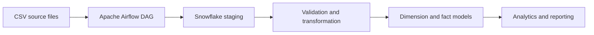

# Cloud Data Warehouse & ETL Orchestration Platform

**Apache Airflow | Snowflake | Python | SQL | PySpark | Delta Lake**

## Business scenario
Create an orchestrated analytical data pipeline that loads customer data into a cloud warehouse, validates source records, and maintains historical customer attributes using Slowly Changing Dimension (SCD) Type 2.

## Architecture

## Repository structure
- `dags/warehouse_pipeline.py`: starter Airflow DAG.
- `sql/01_create_objects.sql`: staging and dimension DDL.
- `sql/02_scd_type2_merge.sql`: illustrative SCD Type 2 SQL.
- `data/customers_sample.csv`: synthetic source data.
- `docs/architecture.md`: design and operational notes.
- `tests/TEST_PLAN.md`: validation checklist.
- `requirements.txt`: dependency starting point.

## Setup
1. Install an Apache Airflow release using its official constraints file for your Python version.
2. Install a Snowflake provider version compatible with that Airflow release.
3. Configure an Airflow connection named `snowflake_default` through the UI or a secrets backend.
4. Create a development database, schema, warehouse and least-privilege role in Snowflake.
5. Review and execute the SQL setup script in the development schema.
6. Place the DAG in the configured Airflow DAG folder and validate it before triggering.

Never commit passwords, private keys, account identifiers or tokens. Pin compatible versions for your environment before deployment.

## Current implementation status
This repository contains an initial DAG, SQL examples, synthetic CSV data and design documentation. **A live Airflow deployment, authenticated Snowflake connection, successful end-to-end run, SCD2 validation and automated test results have not yet been verified.** These are planned implementation and validation tasks.

## Planned enhancements
Incremental loading with watermarks, staging ingestion, data quality checks, audit logging, idempotent reruns, SCD2 edge-case handling, retries/alerts, CI/CD and execution evidence.

All included sample data is synthetic. No client/employer code or confidential data is included.
